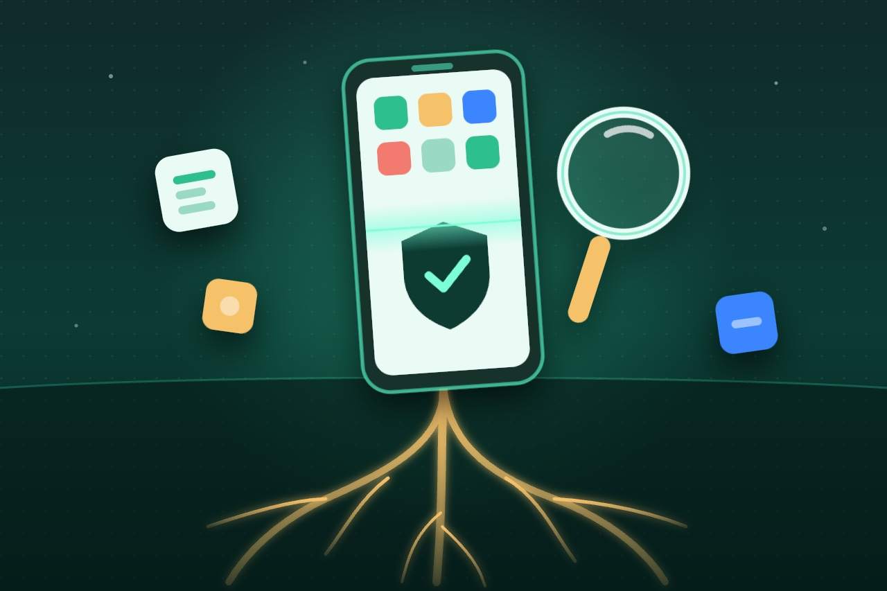
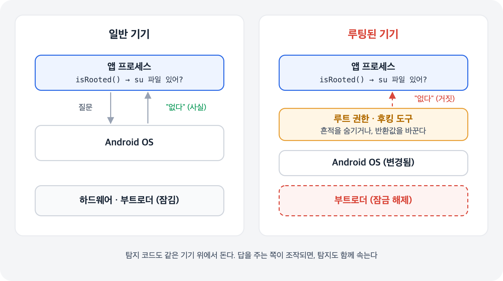
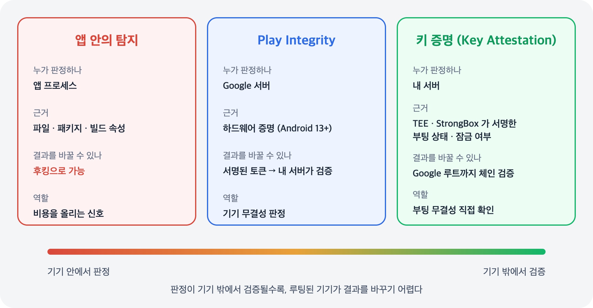
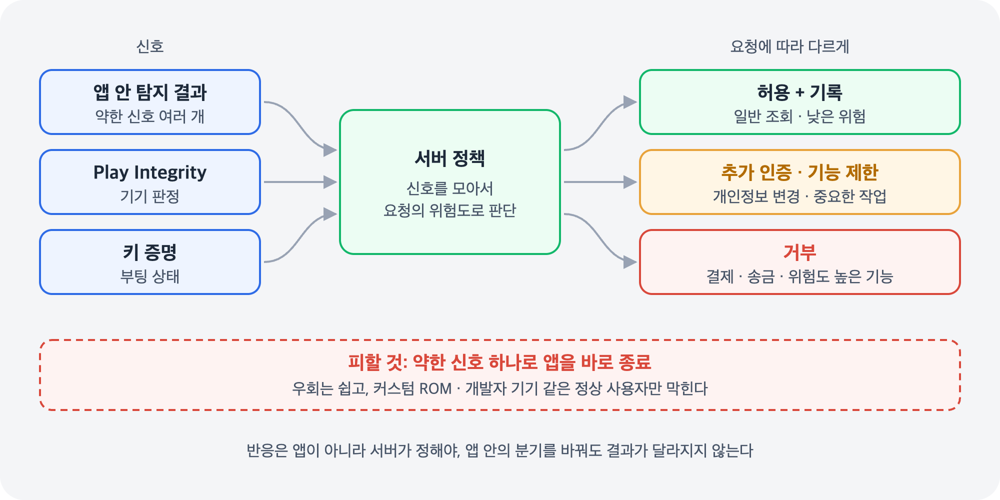

## 개요

앞의 글들은 모두 같은 전제를 깔고 있었다. 공격자가 기기를 장악하면 앱 안의 방어는 결국 우회될 수 있다는 것이다. 기기를 장악하는 가장 흔한 방법이 **루팅**이고, 그래서 많은 앱이 실행할 때 "이 기기가 루팅됐는가"를 먼저 확인한다.

그런데 루팅 탐지는 그 자체가 앱 안의 방어다. 탐지 코드도 루팅된 기기 위에서 돌아간다. 이 글에서는 앱 안에서 루팅을 어떻게 탐지하는지, 그 탐지가 왜 결국 우회되는지, 그리고 기기 밖에서 검증할 수 있는 **하드웨어 기반 증명**과 탐지했을 때의 반응까지 정리한다.

## 루팅이란

루팅은 기기에서 최고 권한(root)을 얻어, 앱 샌드박스와 읽기 전용 시스템 영역의 경계를 넘는 것이다. 루팅으로 무엇이 가능해지는지는 [루팅, 중간자 공격, 후킹, Frida — 앱 보안의 공격자 이해하기]() 에서 다뤘다.

요즘 루팅은 대부분 **부트로더 잠금 해제**에서 시작한다. 부트로더가 잠겨 있으면 검증 부팅(Verified Boot)이 제조사가 서명한 이미지만 부팅하게 막는다. 잠금을 풀어야 수정한 부트 이미지를 올릴 수 있고, 이 상태는 뒤에서 볼 하드웨어 증명에 그대로 기록된다.

## 앱 안에서 하는 탐지

OWASP 모바일 보안 테스트 가이드(MASTG)는 앱 안에서 쓰이는 대표적인 루팅 탐지 방법을 이렇게 정리한다.

| 확인하는 것 | 예 | 한계 |
| --- | --- | --- |
| 파일 존재 | `su` 바이너리, 루팅 앱이 남기는 파일과 디렉터리 | 경로를 바꾸거나 앱에게만 안 보이게 숨길 수 있다 |
| 명령 실행 | `su` 실행을 시도해 성공하는지 본다 | 파일 확인과 같은 한계 |
| 설치된 패키지 | 루팅 관리 앱의 패키지 이름 | Android 11부터 패키지 가시성 제한으로, 매니페스트의 `queries` 요소에 선언하지 않으면 안 보인다. 패키지 이름도 바뀔 수 있다 |
| 빌드 속성 | `Build.TAGS` 에 `test-keys` 가 있는지 (커스텀 ROM의 흔적) | 공식 이미지를 그대로 쓰는 루팅은 잡지 못한다 |
| 파티션 상태 | 읽기 전용이어야 할 시스템 파티션이 쓰기 가능으로 마운트됐는지 | 시스템 파티션을 건드리지 않는 루팅에는 흔적이 없다 |
| 분석 도구 흔적 | 프로세스 메모리 매핑(`/proc/self/maps`)의 후킹 라이브러리, 기본 포트 | 이름·경로·포트는 바꿀 수 있다 |

MASTG도 이런 탐지는 하나만으로는 효과가 크지 않고, 여러 검사를 앱 곳곳에 흩어 두어야 전체 방어의 효과가 올라간다고 설명한다. 또 분석 도구 흔적 같은 약한 신호 하나만 보고 앱을 바로 종료하는 것은 피하라고 권한다.

## 왜 결국 우회되는가

### 1. 탐지 코드도 같은 기기 위에서 돈다

앱이 "이 파일이 있는가", "이 패키지가 설치돼 있는가"를 물으면 답은 OS가 준다. 루트 권한을 가진 쪽은 앱보다 높은 위치에 있어서, 앱이 받는 답을 조작할 수 있다. 앱은 거짓 답을 받아도 그게 거짓인지 알 방법이 없다.

### 2. 흔적을 숨기는 기능이 기본으로 있다

현재 널리 쓰이는 루팅 도구인 Magisk는 시스템 파티션을 직접 고치지 않고 부트 이미지를 수정하는 방식이라, 파티션 검사에 흔적이 남지 않는다. 또 v24.0(2022년)부터는 사용자가 고른 앱의 프로세스에서 Magisk의 변경 사항을 되돌리는 **DenyList** 기능을 제공한다. 탐지하는 앱 입장에서는 그 앱에게만 루팅 흔적이 보이지 않게 된다.

### 3. 탐지 결과도 결국 앱 안의 값이다

여러 검사를 조합해도 마지막에는 `isRooted()` 같은 함수가 `true` / `false` 를 돌려준다. 루팅된 기기에서는 후킹으로 이 반환값을 바꿀 수 있다. Play Integrity 글에서 본 "앱이 결정하면 우회된다"와 같은 구조다.

### 그래도 하는 이유

MASTG도 충분한 시간과 도구를 가진 공격자라면 앱 안의 보호 기술(RASP)을 결국 우회할 수 있다고 본다. 그렇다고 앱 안의 탐지가 의미 없는 것은 아니다. 루팅 도구를 기본 설정으로 쓰는 사람, 알려진 도구를 그대로 쓰는 자동화된 공격은 걸러낸다. 우회하려면 시간과 지식이 필요해지므로 분석 비용이 올라간다. 다만 이것은 **막는 것이 아니라 늦추는 것**이고, 결과를 서버에 보내는 **신호** 중 하나로 다뤄야 한다.

## 기기 밖에서 검증하는 판정

앱 안의 판정을 믿기 어렵다면, 판정을 기기 밖에서 검증할 수 있어야 한다. Android에는 하드웨어가 서명한 기기 상태를 서버가 직접 확인하는 방법이 있다.

### Play Integrity의 기기 판정

Play Integrity API는 Google 서버가 기기 상태를 판정해 서명된 토큰으로 돌려준다. 루팅과 관련해 기준이 되는 값은 `MEETS_DEVICE_INTEGRITY` 다. Android 13 이상에서는 부트로더가 잠겨 있고 인증된 제조사 이미지로 부팅했다는 **하드웨어 기반 증명**이 있어야 이 값을 받는다. 판정 종류와 흐름은 [Play Integrity API — 기기와 앱의 무결성은 서버가 판정한다]() 에서 다뤘다.

### 키 증명 (Key Attestation)

Android Keystore로 키를 만들 때 증명을 요청하면, 기기의 보안 하드웨어(TEE 또는 StrongBox)가 키 정보와 기기의 부팅 상태를 담은 인증서를 만들어 서명해 준다. 이 인증서의 `RootOfTrust` 에는 부트로더가 잠겨 있는지(`deviceLocked`), 검증 부팅이 통과했는지(`verifiedBootState`)가 들어 있다.

서버는 이 인증서 체인이 Google 증명 루트까지 서명으로 이어지는지, 폐기된 인증서는 없는지, 서버가 준 일회용 값(challenge)이 들어 있는지 확인한 뒤 부팅 상태를 읽는다. 서명은 보안 하드웨어 안의 비밀 키로 만들어지므로, 앱이나 OS를 조작해도 인증서의 내용은 바꿀 수 없다.

검증은 반드시 기기가 아닌 서버에서 한다. 동작 원리와 서버의 판단 과정은 [키 증명(Key Attestation) — 기기 상태를 하드웨어의 서명으로 확인하기]() 에서 자세히 다룬다.

### 하드웨어 증명이 알려 주지 않는 것

하드웨어 증명이 확인하는 것은 **부팅 시점의 상태**다. 부트로더가 잠겨 있고 공식 이미지로 부팅했다면 루팅 가능성은 크게 낮아지지만, 실행 중에 생긴 문제까지 모두 보장하지는 않는다. 또 부트로더 잠금 해제가 곧 악의를 뜻하지도 않는다. 개발자 기기나 커스텀 ROM 사용자처럼 정상 사용자도 여기에 걸린다.

## 탐지했을 때 어떻게 반응할까

탐지 자체보다 중요한 것이 탐지 후의 반응이다.

- **반응은 서버가 정한다** — 앱 안에서 "루팅이면 종료"로 분기하면, 그 분기를 바꾸는 것으로 끝난다. 신호를 서버로 보내고 서버가 요청을 처리할지 정해야 앱을 조작해도 결과가 달라지지 않는다
- **요청의 위험도에 따라 다르게** — 일반 조회는 허용하고 기록만 남기고, 개인정보 변경 같은 작업은 추가 인증을 요구하고, 결제·송금처럼 피해가 큰 기능만 막는 식으로 나눈다
- **약한 신호 하나로 바로 종료하지 않는다** — 우회하는 사람은 어차피 우회하고, 막히는 것은 오탐된 정상 사용자다
- **사용자에게 이유를 알린다** — 막아야 한다면 왜 막는지 안내해야 지원 문의와 이탈을 줄일 수 있다

OWASP MASVS는 이런 보호 수단이 없다는 것만으로 취약점은 아니라고 말한다. 또 정부·공공 서비스처럼 접근성이 중요한 앱에서는 플랫폼 차이로 생기는 오탐이 정상 사용자를 배제할 수 있다는 점도 짚는다. 앱의 위협 모델에 맞춰 수준을 정하면 된다.

## 정리

| 항목 | 내용 |
| --- | --- |
| 앱 안의 탐지 | 파일·패키지·빌드 속성·분석 도구 흔적을 본다. 같은 기기 위에서 돌아서 결과를 조작할 수 있다 |
| 우회되는 이유 | OS가 주는 답 조작, 흔적 숨김(DenyList), 반환값 후킹 |
| 기기 밖 판정 | Play Integrity `MEETS_DEVICE_INTEGRITY`, 키 증명 `RootOfTrust`. 반드시 서버에서 검증한다 |
| 한계 | 하드웨어 증명은 부팅 시점의 상태다. 부트로더 잠금 해제가 곧 악의는 아니다 |
| 반응 | 서버가 요청의 위험도에 따라 허용·추가 인증·거부를 정한다 |

<aside markdown="1">
💡 포인트

앱 안의 루팅 탐지는 루팅된 기기 위에서 돈다. 막는 것이 아니라 비용을 올리는 신호다.

믿을 수 있는 판정은 하드웨어가 서명하고 서버가 검증한 것이다.

탐지보다 반응이 중요하다. 반응은 서버가 요청의 위험도에 맞춰 정한다.

</aside>

## 참조

[MASTG-KNOW-0027: Root Detection](https://mas.owasp.org/MASTG/knowledge/android/MASVS-RESILIENCE/MASTG-KNOW-0027/)

[MASTG-KNOW-0030: Reverse Engineering Tool Detection](https://mas.owasp.org/MASTG/knowledge/android/MASVS-RESILIENCE/MASTG-KNOW-0030/)

[MASTG-KNOW-0118: Runtime Application Self-Protection (RASP)](https://mas.owasp.org/MASTG/knowledge/android/MASVS-RESILIENCE/MASTG-KNOW-0118/)

[MASVS-RESILIENCE](https://mas.owasp.org/MASVS/11-MASVS-RESILIENCE/)

[Integrity verdicts](https://developer.android.com/google/play/integrity/verdicts)

[Verify hardware-backed key pairs with key attestation](https://developer.android.com/privacy-and-security/security-key-attestation)

[Key and ID attestation](https://source.android.com/docs/security/features/keystore/attestation)

[Package visibility filtering on Android](https://developer.android.com/training/package-visibility)

[Magisk Changelog](https://topjohnwu.github.io/Magisk/changes.html)
