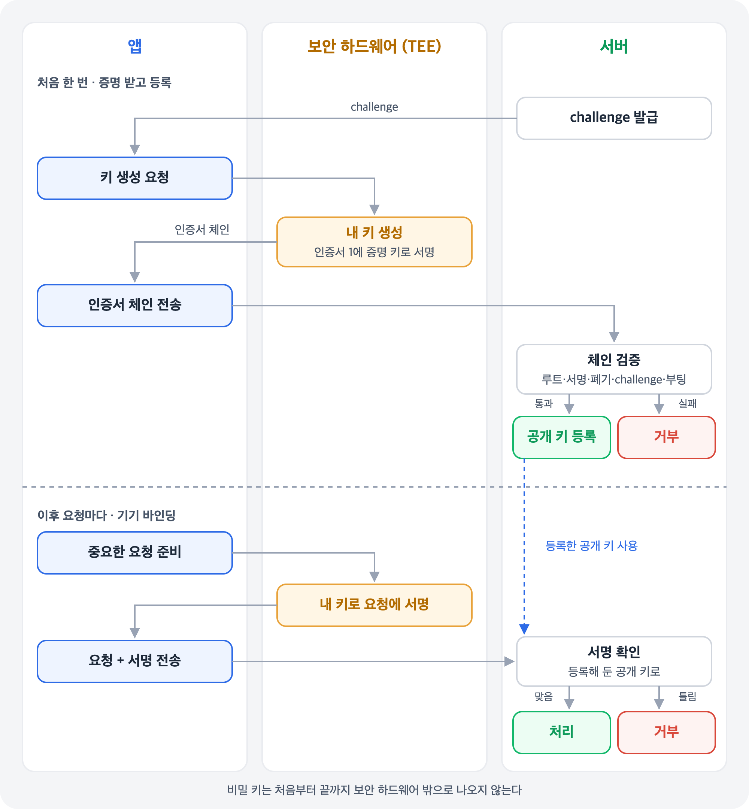
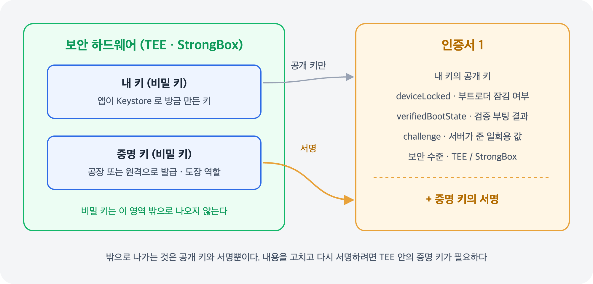
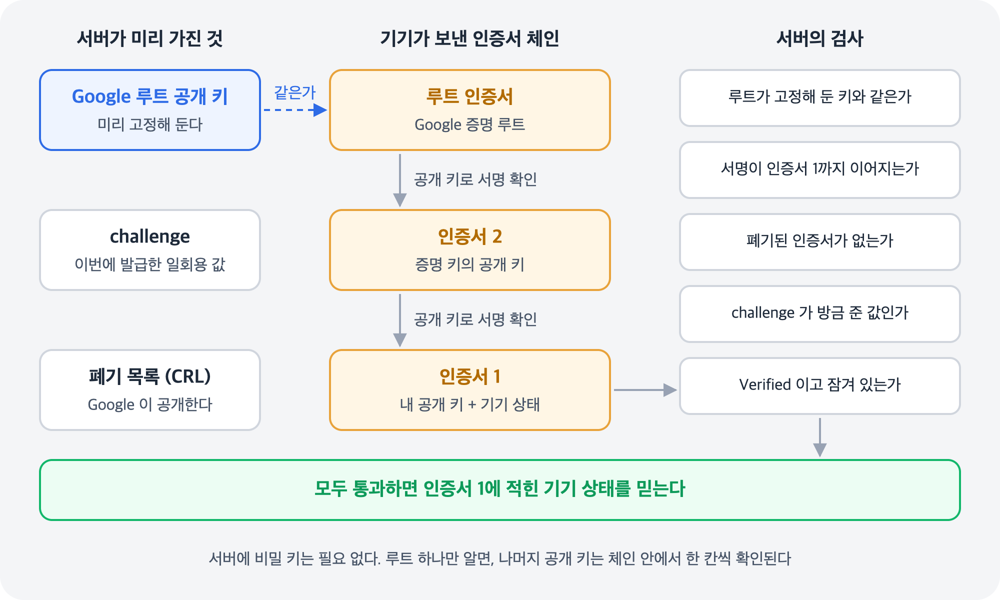

## 개요

[루팅 탐지]() 글에서 앱이 스스로 내리는 판정은 우회될 수 있고, 믿을 수 있는 판정은 기기 밖에서 검증해야 한다고 했다. 그 방법은 두 가지다. Google 서버의 판정을 받아 오는 **Play Integrity**, 그리고 기기의 보안 하드웨어가 서명한 기기 상태를 내 서버가 직접 검증하는 **키 증명**(Key Attestation)이다.

키 증명은 Android Keystore로 만든 키가 보안 하드웨어 안에 있다는 것을 증명하는 기능이다. Android 7.0부터 지원하고, 이 증명서에 부트로더 잠금 여부와 검증 부팅 결과 같은 **기기의 부팅 상태**가 함께 담긴다. 그래서 루팅 여부를 판단하는 근거로 쓸 수 있다.

## 한눈에 보기



1. 서버가 일회용 값(challenge)을 주면, 앱은 그 값을 넣어 보안 하드웨어에 키를 만든다
2. 보안 하드웨어는 키 정보와 기기 상태를 담은 인증서에 서명하고, 앱은 이 인증서 체인을 서버로 보낸다
3. 서버는 체인을 검증하고, 통과하면 그 키의 공개 키를 등록해 이후 요청을 확인하는 데 쓸 수 있다

## 왜 믿을 수 있나

Android 기기에는 일반 OS와 분리된 보안 영역인 **TEE**(Trusted Execution Environment)가 있고, 일부 기기에는 별도 보안 칩인 **StrongBox**도 있다. Keystore로 만든 키는 이 영역 안에서 만들어지고 밖으로 나오지 않는다. 키 증명에는 이 영역 안의 두 키가 쓰인다.

| 키 | 어떻게 생기나 | 역할 |
| --- | --- | --- |
| 증명 키 | 기기에 미리 들어 있다 (최근 기기는 원격으로 발급받는다) | 증명서에 서명하는 "도장" |
| 내 키 | 앱이 `KeyPairGenerator` 에 `"AndroidKeyStore"` 를 지정해 만든다 | 증명을 받을 대상 |

앱이 키를 만들 때 증명을 요청하면, 보안 하드웨어가 내 키의 공개 키와 기기 상태를 담은 인증서를 만들고 증명 키로 서명한다. 이 글에서는 이것을 **인증서 1**이라고 부른다.



밖으로 나가는 것은 공개 키와 서명뿐이다. 루팅된 기기에서 OS가 인증서 1의 `deviceLocked` 를 참으로 고치면 서명이 맞지 않게 되고, 다시 서명하려면 보안 하드웨어 안의 증명 키가 필요하다. OS도 이 키를 꺼낼 수 없다.

루팅 여부만 알고 싶어도 키를 만들어야 하는 이유는, Android에 "기기 상태를 증명해 달라"는 API가 따로 없기 때문이다. 증명은 항상 키에 붙어서 나오고, 기기 상태는 그 증명서에 함께 실려 온다.

## 인증서 1에 담기는 것

| 항목 | 내용 |
| --- | --- |
| 공개 키 | 앱이 만든 내 키의 공개 키 |
| `attestationChallenge` | 키를 만들 때 넣은 일회용 값. 서버가 발급한 값과 비교한다 |
| `attestationSecurityLevel` | 증명을 만든 환경. `TrustedEnvironment`(TEE) 또는 `StrongBox` 여야 하드웨어 기반이다 |
| `deviceLocked` | 부트로더가 잠겨 있는가 |
| `verifiedBootState` | `Verified`: 신뢰 체인이 이어진 정상 부팅<br>`SelfSigned`: 사용자가 설정한 신뢰 루트로 검증<br>`Unverified`: 부트로더 잠금 해제<br>`Failed`: 검증 실패 |

`deviceLocked` 와 `verifiedBootState` 는 `RootOfTrust` 라는 구조 안에 들어 있다. 공식 문서는 체인 안에서 이 증명 정보가 처음 나오는 것, 즉 인증서 1의 것만 믿으라고 안내한다.

## 앱에서 하는 일

앱이 할 일은 단순하다. 서버에서 challenge를 받아 키를 만들고, 인증서 체인을 서버로 보낸다. 판단은 하지 않는다.

```kotlin
// 서버에서 받은 일회용 challenge 로 증명용 키를 만든다
val spec = KeyGenParameterSpec.Builder("attest_key", KeyProperties.PURPOSE_SIGN)
    .setAlgorithmParameterSpec(ECGenParameterSpec("secp256r1"))
    .setDigests(KeyProperties.DIGEST_SHA256)
    .setAttestationChallenge(challengeFromServer)
    .build()

KeyPairGenerator.getInstance(KeyProperties.KEY_ALGORITHM_EC, "AndroidKeyStore").apply {
    initialize(spec)
    generateKeyPair()
}

// 증명 정보가 담긴 인증서 체인 → 서버로 보낸다
val keyStore = KeyStore.getInstance("AndroidKeyStore").apply { load(null) }
val chain = keyStore.getCertificateChain("attest_key")
```

위 코드는 Android Keystore API 형식에 맞춰 쓴 것으로, 직접 빌드해 보지는 않은 **예시**다.

## 서버에서 하는 일

서버는 하드웨어 안의 비밀 키를 볼 필요가 없다. 비밀 키로 만든 **서명**만 확인하면 되고, 서명은 공개 키로 확인할 수 있다.



서버는 공식 문서에 공개된 **Google 증명 루트 인증서**를 미리 갖고 있다가 다음 순서로 판단한다.

1. 체인의 루트가 Google 증명 루트인지 확인한다. 다른 루트라면 하드웨어 보안을 보장하지 않는다
2. 루트에서부터 한 칸씩 내려오며, 위 인증서의 공개 키로 아래 인증서의 서명을 확인한다
3. 체인에 폐기된 인증서가 없는지 Google이 공개하는 폐기 목록(CRL)으로 확인한다
4. 인증서 1의 challenge가 방금 발급한 값인지 확인한다. 예전 인증서의 재사용을 막는다
5. 보안 수준이 TEE 또는 StrongBox이고, `Verified` 이면서 `deviceLocked` 가 참인지 확인한다

Google 서버에 기기별 인증서를 대조하는 방식이 아니다. 브라우저가 처음 보는 사이트의 인증서를 루트 CA까지 따라가 확인하는 HTTPS 검증과 같은 구조이고, 믿는 루트를 Google 증명 루트로 고정한다는 점은 피닝과 닮았다. 검증은 반드시 **기기가 아닌 서버**에서 해야 한다.

### 검증은 공식 라이브러리로

직접 구현할 필요는 없다. 공식 문서는 서버에서 Google의 Kotlin 라이브러리(`android/keyattestation`)를 쓰라고 권한다. 위 1~4단계가 `verify()` 한 번에 들어 있다.

```kotlin
val verifier = Verifier(
  GoogleTrustAnchors,                  // Google 증명 루트들
  ::getGoogleRevocationStatusFromWeb,  // 폐기 목록
  { Instant.now() },
  attestationApplicationId = expectedAppId,
)

when (val result = verifier.verify(certificateChain, challengeChecker)) {
  is VerificationResult.Success -> {
    result.publicKey          // 등록할 내 키의 공개 키
    result.verifiedBootState  // 정책 판단에 쓴다
  }
  else -> // challenge 불일치, 체인 검증 실패 등
}
```

위 코드는 라이브러리 README의 예시를 줄인 것으로, 직접 빌드해 보지는 않았다. README는 challenge에 **요청의 고유한 정보**와 **서버가 서명한 타임스탬프**를 넣어, 다른 기기의 증명을 가져다 쓰거나 오래된 증명을 재사용하는 공격을 막으라고 권한다. 서버가 JVM이 아니라면 Google의 Bouncy Castle 기반 파싱 샘플을 참고할 수 있다.

## 기기 바인딩

증명을 한 번 받고 끝낼 수도 있지만, 내 키를 남겨 두면 더 쓸모가 있다. 서버가 증명을 검증한 뒤 인증서 1의 공개 키를 등록해 두고, 이후 앱이 중요한 요청을 보낼 때마다 이 키로 서명하게 하는 것이다.

비밀 키는 하드웨어 밖으로 나오지 않으므로, 토큰을 훔쳐 다른 기기에서 요청해도 같은 서명을 만들 수 없다. "증명을 통과한 기기"와 "실제로 요청을 보낸 기기"가 같다는 것을 요청마다 확인할 수 있어서, 판정과 실제 요청이 따로 노는 문제를 막는다. 이를 **기기 바인딩**(device binding)이라고 한다.

## Play Integrity와 비교

|  | Play Integrity | 키 증명 |
| --- | --- | --- |
| 판정하는 쪽 | Google 서버가 판정해 결과를 준다 | 내 서버가 인증서를 직접 검증한다 |
| 결과 형태 | `MEETS_DEVICE_INTEGRITY` 같은 레이블 | `deviceLocked`, `verifiedBootState` 같은 원본 값 |
| 확인하는 범위 | 기기 무결성 + 앱 무결성 + 계정 라이선스 | 키가 보안 하드웨어에 있는지 + 부팅 상태 |
| 필요한 것 | Google Play 서비스, Play Console 설정 | Android Keystore와 검증 서버 |
| 이후 요청 | 확인할 때마다 토큰을 새로 받는다 | 등록한 키로 요청마다 서명할 수 있다 |

둘 중 하나만 고를 필요는 없다. Play Integrity는 앱이 변조됐는지까지 한 번에 확인해 주고, 키 증명은 Google Play 서비스가 없어도 쓸 수 있고 기기 바인딩으로 이어질 수 있다.

## 한계

- **부팅 시점의 상태다** — 실행 중에 생긴 문제까지 보장하지는 않는다
- **부트로더 잠금 해제가 곧 악의는 아니다** — 개발자 기기나 커스텀 ROM 사용자도 걸린다
- **증명을 못 받는 기기가 있다** — 보안 하드웨어가 없는 기기, Android 7.0 미만 기기, 에뮬레이터는 증명이 실패하거나 보안 수준이 `Software` 로 나온다. 이때는 "루팅됨"이 아니라 **"판단 불가"**로 다루고 다른 신호로 판단한다. StrongBox만 없다면 TEE로 다시 만들면 된다
- **증명 키가 유출될 수 있다** — 그래서 폐기 목록 확인이 필수다
- **체인 형식은 바뀐다** — Android 13부터 증명 키를 원격으로 발급(RKP)하면서 체인이 길어졌고, 새 루트도 추가됐다. 체인 모양을 코드에 고정하지 말고 공식 라이브러리에 맡긴다

## 정리

| 항목 | 내용 |
| --- | --- |
| 무엇을 증명하나 | 키가 보안 하드웨어에 있다는 것, 그리고 부트로더 잠금·검증 부팅 상태 |
| 누가 서명하나 | TEE·StrongBox 안의 증명 키. 비밀 키는 밖으로 나오지 않는다 |
| 앱이 하는 일 | challenge로 키를 만들고 인증서 체인을 보낸다 |
| 서버가 하는 일 | Google 루트까지 서명 확인 → 폐기·challenge·부팅 상태 확인. 공식 라이브러리로 |
| 활용 | 한 번 확인하거나, 키를 등록해 요청마다 서명하는 기기 바인딩 |

<aside markdown="1">
💡 포인트

키 증명은 앱이 아니라 보안 하드웨어가 기기 상태를 서명해 준다. OS가 장악돼도 서명된 내용은 바꿀 수 없다.

서버에는 비밀 키가 필요 없다. Google 루트만 알면 나머지는 체인을 따라 확인된다.

증명을 못 받는 기기는 "루팅됨"이 아니라 "판단 불가"다.

</aside>

## 참조

[Verify hardware-backed key pairs with key attestation](https://developer.android.com/privacy-and-security/security-key-attestation)

[Key and ID attestation](https://source.android.com/docs/security/features/keystore/attestation)

[Remote Key Provisioning](https://source.android.com/docs/core/ota/modular-system/remote-key-provisioning)

[Android Keystore system](https://developer.android.com/privacy-and-security/keystore)

[Keystore Key Attestation](https://android-developers.googleblog.com/2017/09/keystore-key-attestation.html)

[Upgrading Android Attestation: Remote Provisioning](https://android-developers.googleblog.com/2022/03/upgrading-android-attestation-remote.html)

[android/keyattestation](https://github.com/android/keyattestation)

[googlesamples/android-key-attestation](https://github.com/googlesamples/android-key-attestation)

[Integrity verdicts](https://developer.android.com/google/play/integrity/verdicts)
