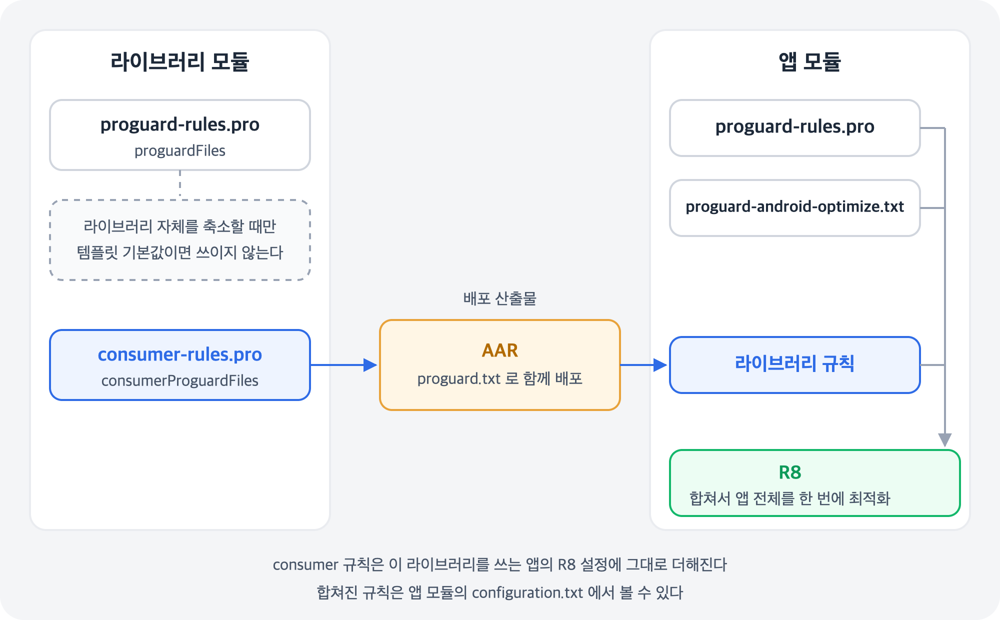

## 개요

[난독화]() 글에서 R8이 코드를 지우고 이름을 바꾸며, 지우면 안 되는 코드는 keep 규칙으로 알려 준다는 것을 봤다.

Android Studio에서 라이브러리 모듈을 만들면 이 규칙 파일이 두 개 생긴다. `proguard-rules.pro` 와 `consumer-rules.pro` 다. 문법은 똑같지만 **누구에게 적용되는지**가 다르다. 이 글에서는 그 차이와, 어느 파일에 무엇을 써야 하는지를 정리한다.

## 한눈에 보기



- `proguard-rules.pro` — **내 모듈을** 빌드할 때 R8이 읽는 규칙
- `consumer-rules.pro` — **내 라이브러리를 가져다 쓰는 앱**에 함께 보내는 규칙

라이브러리를 택배라고 생각하면, `consumer-rules.pro` 는 상자에 같이 넣는 "취급 주의" 메모다. 라이브러리를 빌드하면 이 파일이 AAR 안에 `proguard.txt` 로 들어가고, 앱을 빌드할 때 R8이 앱의 규칙과 함께 읽는다. 앱 개발자가 라이브러리 내부 사정을 몰라도 릴리스 빌드가 깨지지 않는 이유다.

| 항목 | `proguard-rules.pro` | `consumer-rules.pro` |
| --- | --- | --- |
| 연결하는 설정 | `proguardFiles` | `consumerProguardFiles` |
| 적용 대상 | 이 모듈 자신 | 이 라이브러리를 쓰는 앱 |
| 주로 쓰는 곳 | 앱 모듈 | 라이브러리 모듈 |

## 가장 흔한 실수

라이브러리 모듈을 만들면 빌드 스크립트가 이렇게 생성된다.

```kotlin
// 라이브러리 모듈의 build.gradle.kts
android {
    defaultConfig {
        consumerProguardFiles("consumer-rules.pro")   // 앱에 보내는 규칙
    }
    buildTypes {
        release {
            isMinifyEnabled = false                    // 라이브러리 자체는 R8을 돌리지 않는다
            proguardFiles(
                getDefaultProguardFile("proguard-android-optimize.txt"),
                "proguard-rules.pro"
            )
        }
    }
}
```

`isMinifyEnabled = false` 이므로 라이브러리의 `proguard-rules.pro` 는 **아무도 읽지 않는다**. 라이브러리에 필요한 규칙을 여기에 적으면 앱의 R8은 그 규칙을 모른 채 코드를 지우거나 이름을 바꾼다. 디버그 빌드에서는 멀쩡하다가 **릴리스 빌드에서만 크래시**가 나는 흔한 원인이다.

라이브러리에 필요한 규칙은 `consumer-rules.pro` 에 쓴다.

## `consumer-rules.pro` 에 쓰는 것

라이브러리가 **이름으로 찾는 코드**만 쓴다. 리플렉션으로 만드는 클래스나 네이티브 코드(JNI)가 부르는 메서드 같은 것이다. 범위는 최대한 좁게 잡는다.

```txt
# 라이브러리가 리플렉션으로 만드는 Plugin 구현체: 기본 생성자만 남긴다
-keep class * implements com.example.mylibrary.Plugin {
    <init>();
}
```

위 규칙은 설명을 위한 **검증 안 된 예시**다.

## `consumer-rules.pro` 에 쓰면 안 되는 것

이 파일의 규칙은 라이브러리를 쓰는 **앱 전체**에 더해진다. 그래서 다음은 넣지 않는다.

| 넣지 않는 것 | 이유 |
| --- | --- |
| 패키지 전체 keep<br>`-keep class com.mylibrary.** { *; }` | 이 라이브러리를 쓰는 모든 앱에서 해당 코드의 최적화가 막힌다 |
| 전역 옵션<br>`-dontobfuscate`, `-dontoptimize` 등 | 라이브러리만이 아니라 **앱 전체**에 적용된다. 앱 개발자가 모르는 사이에 앱 전체의 난독화가 꺼질 수 있다 |

AGP 9.0부터는 이 실수를 도구가 막아 준다. consumer 규칙에 전역 옵션이 있으면 라이브러리 배포가 실패하고, 앱 빌드는 이미 배포된 라이브러리에 들어 있는 전역 옵션을 무시한다.

## 적용된 규칙 확인하기

앱을 릴리스 빌드하면 앱 모듈의 `build/outputs/mapping/release/configuration.txt` 에 앱과 모든 라이브러리의 규칙이 합쳐져 기록된다. 의심 가는 규칙이 어디서 왔는지 여기서 찾으면 된다.

## 정리

| 이런 규칙이라면 | 여기에 쓴다 |
| --- | --- |
| 앱 코드가 리플렉션으로 쓰는 클래스 | 앱 모듈 `proguard-rules.pro` |
| 규칙을 제공하지 않는 외부 라이브러리용 규칙 | 앱 모듈 `proguard-rules.pro` |
| 내 라이브러리가 리플렉션·JNI로 찾는 코드 | 라이브러리 모듈 `consumer-rules.pro` |
| 라이브러리 모듈 `proguard-rules.pro` | 라이브러리 자체를 미리 축소할 때만 쓴다. 보통은 비워 둔다 |

<aside markdown="1">
💡 포인트

proguard-rules.pro 는 내 모듈용, consumer-rules.pro 는 나를 쓰는 앱용이다.

라이브러리 규칙을 라이브러리의 proguard-rules.pro 에 쓰면 아무 효과가 없다. 릴리스 빌드에서만 크래시가 난다면 이것부터 확인하자.

consumer 규칙에는 꼭 필요한 keep만 좁게 쓰고, 패키지 전체 keep과 전역 옵션은 넣지 말자.

</aside>

## 참조

[Optimization for library authors](https://developer.android.com/topic/performance/app-optimization/library-optimization)

[Create an Android library](https://developer.android.com/studio/projects/android-library)

[Global options](https://developer.android.com/topic/performance/app-optimization/global-options)

[Fix optimization problems](https://developer.android.com/topic/performance/app-optimization/test-and-troubleshoot-the-optimization)

[Android Gradle plugin 9.0 release notes](https://developer.android.com/build/releases/agp-9-0-0-release-notes)
